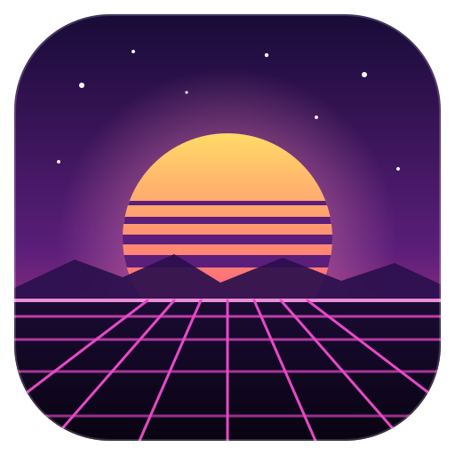
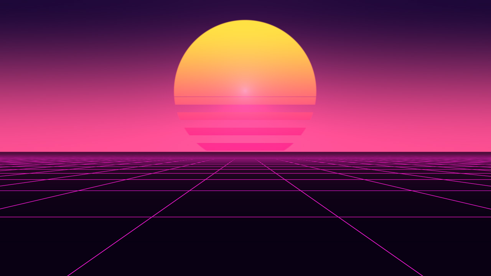
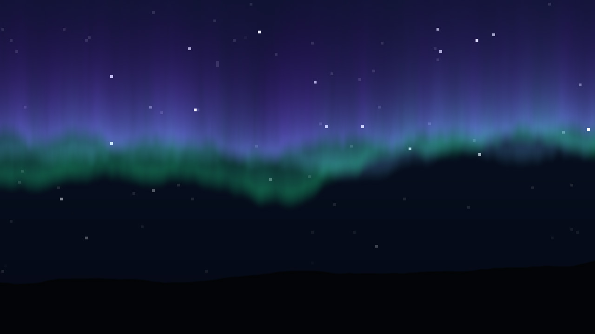
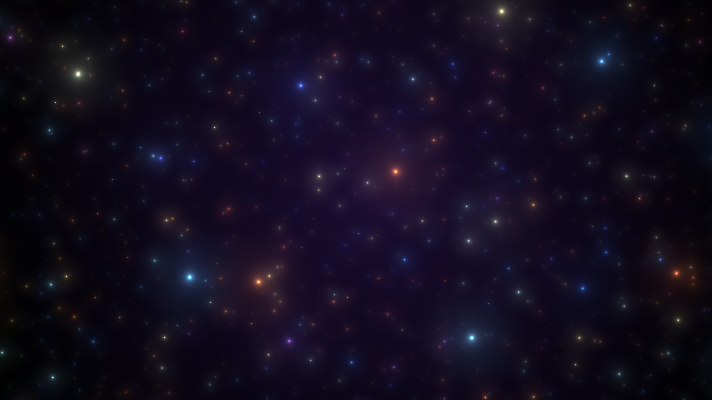

<p align="center">
  
</p>

<h1 align="center">wallengine</h1>

<p align="center">
  Live wallpapers for Linux/X11 in C — Shadertoy shaders, videos, scenes and
  <b>Wallpaper Engine</b> workshop wallpapers.
</p>

<p align="center">
  
  
  
  
  <a href="https://buymeacoffee.com/0xcybersoldier"></a>
</p>

| | |
|:---:|:---:|
|  |  |
|  |  |

## About

A live wallpaper engine for Linux/X11, written in C (OpenGL + Xlib). It plays its own
wallpapers (Shadertoy shaders, images, videos, scenes) **and Wallpaper Engine (Steam
workshop) wallpapers**. The Wallpaper Engine support is a C port of
[linux-wallpaperengine](https://github.com/Almamu/linux-wallpaperengine), so this project is
licensed under the GPLv3 (see `LICENSE`).

## Features

| Feature | How |
|---|---|
| Shader wallpapers | Shadertoy-compatible GLSL (`mainImage`, `iTime`, `iResolution`, `iMouse`, `iDate`, `iFrame`, `iChannel0` = audio) with **live hot-reload** when you save the file |
| Video wallpapers | mp4 / webm / mkv / mov / gif … decoded by `ffmpeg`, looped, optional sound via `ffplay` |
| Image wallpapers | jpg / png / bmp / tga / psd / hdr, with cover / contain / stretch / center fit |
| Scenes | `.scene` file = image or video + mouse parallax + particles (snow, rain, fireflies, bokeh) + tint/brightness/saturation |
| Audio-reactive | captures system output (PipeWire `pw-record` or PulseAudio `parec`), FFT → spectrum + waveform; visualizers: bars, wave, circle |
| Multi-monitor | per-monitor wallpapers, `--screen-root`/`--bg`, spanning across all or some screens |
| Playlists | folders, timed rotation, shuffle, crossfade transitions, Wallpaper Engine playlists from its `config.json` |
| Performance | FPS cap, pauses a monitor when a fullscreen (or maximized) app covers it, optional pause on battery |
| Control | `wallengine ctl …` over a Unix socket: next / prev / set / pause / effect / property / screenshot / status |

### Wallpaper Engine support

| Wallpaper Engine feature | Status |
|---|---|
| Workshop items by id (`wallengine 1845706469`) or folder | ✅ finds Steam's workshop folders automatically |
| `scene.pkg` / `gifscene.pkg` packages, `.tex` textures (LZ4, DXT1/3/5, BC7, R8, RG88, float formats, embedded PNG/JPG, animated GIF frames, spritesheets, embedded MP4) | ✅ |
| Image layers: alignment, parent/child transforms, rotation, color, alpha, brightness, solid / fullscreen / passthrough layers, color blend modes, puppet-warp meshes | ✅ |
| Effects: multi-pass, effect FBOs, binds, `previous`, copy commands, combos, shader constants, user textures | ✅ |
| Wallpaper Engine shaders (HLSL-flavoured GLSL) | ✅ through the patched glslang + SPIRV-Cross that linux-wallpaperengine uses, called from C |
| Camera: orthographic projection, auto size, parallax, bloom (toggle live), camera shake | ✅ |
| Particles: box / sphere emitters, 9 initializers, 12 operators (movement, turbulence, vortex, oscillators…), control points following the mouse, sprite / trail / rope renderers, spritesheets, refraction | ✅ |
| Text layers (fonts from the wallpaper or the system, scripted text) | ✅ |
| Sound layers (Ogg, MP3, WAV, FLAC; loop / once), volume, mute, auto-mute when other apps play audio | ✅ |
| SceneScript (JavaScript): `update/init/destroy`, `thisLayer`, `thisScene.getLayer`, `engine` timers, `input` cursor, `WEMath`/`WEColor`, `Vec2/3/4`, script properties, cursor and media events | ✅ on QuickJS |
| User properties: `--list-properties`, `--set-property`, live changes with `wallengine ctl property` | ✅ |
| Now-playing (MPRIS) info and album-art textures | ✅ via D-Bus |
| Audio-reactive shaders (`g_AudioSpectrum16/32/64`) | ✅ |
| Video wallpapers | ✅ needs `ffmpeg` |
| Web wallpapers | ⚠️ only when built with WebKitGTK (`libwebkit2gtk-4.1-dev`); otherwise a clear error |
| Application wallpapers | ❌ these are Windows programs |
| Wayland | ❌ X11 only (Wayland-only options are accepted and ignored) |

**You need Wallpaper Engine's `assets` folder.** Scene wallpapers use shaders and materials
that ship with Wallpaper Engine itself. Own and install Wallpaper Engine through Steam (it
installs fine under Steam's Linux client with Proton) and wallengine finds it in:

```
~/.steam/steam/steamapps/common/wallpaper_engine/assets
~/.local/share/Steam/steamapps/common/wallpaper_engine/assets
~/.var/app/com.valvesoftware.Steam/.local/share/Steam/steamapps/common/wallpaper_engine/assets
~/snap/steam/common/.local/share/Steam/steamapps/common/wallpaper_engine/assets
```

or pass `--assets-dir PATH`. Subscribe to wallpapers in the Steam workshop; they land in
`steamapps/workshop/content/431960/<id>/` and can be used by id.

## Build

Dependencies: a C and a C++ compiler, `libx11-dev libxext-dev libgl-dev liblz4-dev libdbus-1-dev`.
Optional at runtime: `ffmpeg` (videos), `pipewire-bin` or `pulseaudio-utils` (audio input, sound
output), `libwebkit2gtk-4.1-dev` at build time (web wallpapers).

```sh
make -j$(nproc)                  # first build compiles glslang + SPIRV-Cross (~2 minutes)
./wallengine -m window           # try it in a window first
make install                     # ~/.local/bin + autostart + default config
```

Everything else (cJSON, QuickJS, stb, dr_libs, glslang, SPIRV-Cross) is vendored in
`src/third_party`.

## Usage

```sh
wallengine ~/Wallpapers -i 600 -s          # whole folder, new wallpaper every 10 min, shuffled
wallengine 1845706469                       # a Steam workshop wallpaper by id
wallengine --screen-root eDP-2 --bg 1845706469 --scaling fill \
           --screen-root HDMI-3 --bg ~/shaders/sea.frag
wallengine --screen-span eDP-2,HDMI-3 --bg 2667198601
wallengine -l 2370927443                    # list a wallpaper's properties
wallengine --set-property bloom=1 2370927443
wallengine --playlist "My playlist"         # a playlist from Wallpaper Engine's config.json
wallengine --screenshot ~/wall.png 1845706469   # screenshot after 5 frames (pywal etc.)

wallengine ctl next              # next wallpaper on every monitor (or: ctl next 1)
wallengine ctl set 1 sea.frag    # set monitor 1
wallengine ctl property bloom 0  # change a Wallpaper Engine property live
wallengine ctl properties
wallengine ctl pause | resume | toggle
wallengine ctl status
```

All options are listed by `wallengine --help`; linux-wallpaperengine's options
(`--screen-root`, `--bg`, `--screen-span`, `--scaling`, `--clamp`, `--window`, `--silent`,
`--noautomute`, `--no-audio-processing`, `--screenshot-delay`, `--assets-dir`,
`--disable-particles`, `--disable-mouse`, `--disable-parallax`, `--list-properties`,
`--set-property`, `--dump-structure`, `--render-debug`, `--playlist`, `--no-fullscreen-pause`)
behave the same way. Defaults come from `~/.config/wallengine/config.ini` (see
`contrib/config.ini`).

## Writing your own wallpapers

**Shaders**: paste almost any Shadertoy shader into a `.frag` file. Extra uniforms:
`iBass` and `iLevel` (0..1). `iChannel0` is the audio texture (row 0.25 = spectrum,
row 0.75 = waveform). A `foo.png` next to `foo.frag` is bound to `iChannel1`. Edit the
file while it's running and it reloads on save.

**Scenes** (`.scene`):

```ini
source     = assets/forest.jpg   # image or video, relative to the .scene file
fit        = cover
parallax   = 0.03
effect     = snow                # none | snow | rain | fireflies | bokeh
visualizer = bars                # none | bars | wave | circle
tint       = 1.0 0.95 0.9
```

## Desktop notes

- **XFCE**: the live wallpaper is drawn above xfdesktop, so desktop icons are hidden (clicks
  still reach them). Set *Desktop → Icons → Icon type: None*, or run `xfdesktop --quit`.
- **i3 / bspwm / openbox**: `--mode desktop` or `--mode root`.
- Mouse interaction (parallax, cursor events in scripts) works through pointer polling, so
  the wallpaper never steals clicks.

## Sponsor the project

If wallengine is useful to you, you can sponsor its development:

<p align="center">
  <a href="https://buymeacoffee.com/0xcybersoldier" target="_blank">
    
  </a>
</p>

☕ **[buymeacoffee.com/0xcybersoldier](https://buymeacoffee.com/0xcybersoldier)**

## Credits

- Wallpaper Engine support is ported from [linux-wallpaperengine](https://github.com/Almamu/linux-wallpaperengine) by Almamu and contributors (GPLv3).
- Vendored libraries: [glslang](https://github.com/Almamu/glslang-WallpaperEngine) and [SPIRV-Cross](https://github.com/Almamu/SPIRV-Cross-WallpaperEngine) (patched forks), [QuickJS-ng](https://github.com/quickjs-ng/quickjs), [cJSON](https://github.com/DaveGamble/cJSON), [stb](https://github.com/nothings/stb), [dr_libs](https://github.com/mackron/dr_libs). Their licenses are in `src/third_party`.
- Wallpaper Engine is a product of Kristjan Skutta; this project is not affiliated with it. You need your own copy to use its assets.

## Layout

```
src/main.c          config, CLI, playlists, IPC socket, main loop, pause logic
src/x11.c           desktop window, GLX, monitors, fullscreen detection
src/render.c        shader / image / video / scene wallpapers, transitions
src/video.c         ffmpeg decoding pipe          src/audio.c   audio capture + FFT
src/we/             Wallpaper Engine support (port of linux-wallpaperengine):
  project.c         project.json, Steam paths, properties, materials, effects, models
  core.c            VFS (folders + PKG), JSON helpers, dynamic values bound to properties
  texture.c         .tex parsing, framebuffers     shader.c  WE shader preprocessor + compiler
  pass.c            effect passes                  image.c   image layers
  particle.c        particle systems               text.c    text layers
  sound.c           decoding, mixing, auto-mute    script.c  SceneScript on QuickJS
  media.c           MPRIS now-playing + album art  scene.c   scene graph, camera, bloom
  we.c              top level + scaling modes      web.c     WebKitGTK web wallpapers
```
